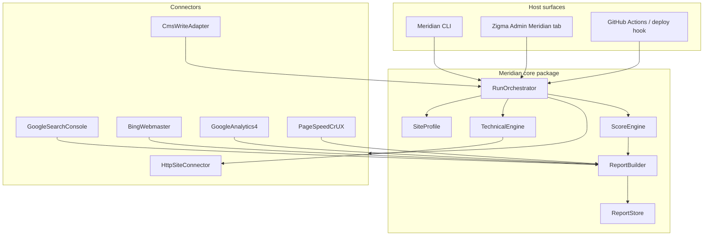

# Meridian — SEO Command Center

**Product:** portable SEO operating system for any website  
**Delivery:** hybrid (1C) — `@justx/meridian` core + thin host adapters (Zigma Admin first)  
**Loop:** observe → score → prescribe → (connectors) act → consolidated report (2C vision)

---

## Positioning

Meridian is not a keyword-stuffing toy and not a single Lighthouse score. It is a **corporate SEO command desk**:

1. **Truth layer** — what the live site actually emits (HTML, headers, robots, sitemap, schema).
2. **Signal layer** — what Google / Bing / analytics believe (Search Console, Bing Webmaster, GA4, CrUX).
3. **Action layer** — prioritized fixes + optional write-backs through CMS adapters.
4. **Memory layer** — versioned reports so score and coverage trend over time.

Comparable market pattern (2026): platform + connectors + scorecard + evidence, not a monolith scraper. Think “Datadog for search presence” rather than “one more SEO chrome extension.”

---

## System map



---

## Site profile (portable config)

Every website Meridian audits is described by a **SiteProfile** JSON (no Zigma coupling):

```json
{
  "schemaVersion": 1,
  "id": "zigma-prod",
  "displayName": "Zigma Technologies",
  "origin": "https://zigma-technologies.com",
  "brand": { "name": "Zigma Technologies", "maxBrandMentionsInTitle": 1 },
  "environments": {
    "production": { "origin": "https://zigma-technologies.com", "indexable": true },
    "preprod": { "origin": "https://justxsystems.com/zigma-technologies", "indexable": false }
  },
  "samplePaths": ["/", "/projects", "/products", "/services", "/contact"],
  "expectNoindex": ["/thank-you", "/search"],
  "wwwHost": "https://www.zigma-technologies.com",
  "connectors": {
    "gsc": { "enabled": true, "siteUrl": "sc-domain:zigma-technologies.com" },
    "bing": { "enabled": true },
    "ga4": { "enabled": true, "propertyId": "" },
    "pagespeed": { "enabled": true },
    "cms": { "enabled": true, "adapter": "zigma" }
  }
}
```

Copy the profile to another repo / client; point CLI at it — same binary.

---

## Consolidated report schema (`MeridianReport` v1)

Machine-readable, versioned, UI-agnostic:

| Block | Purpose |
| --- | --- |
| `meta` | run id, timestamps, profile id, meridian version, duration |
| `scorecard` | overall 0–100 + pillar scores (technical, content, local, authority, signals) |
| `findings[]` | severity, code, title, evidence, remediation, owner (`dev` \| `marketing` \| `ops`) |
| `pages[]` | per-URL technical facts (title, canonical, robots, h1, og, schema types) |
| `signals` | GSC / Bing / GA4 / CrUX snapshots (null when connector not authenticated) |
| `connectors` | status per connector: `ok` \| `auth_required` \| `error` \| `skipped` |
| `roadmap` | ordered next actions with phase tags aligned to SEO-GUIDE |

Artifacts per run:

- `report.json` — source of truth  
- `report.html` — executive boardroom view  
- `report.md` — engineer paste into PR / ticket  

---

## Connectors (2C surface)

Each connector implements:

```ts
interface MeridianConnector {
  id: string;
  label: string;
  auth: 'none' | 'oauth2' | 'api_key';
  probe(): Promise<ConnectorStatus>;
  collect(ctx: RunContext): Promise<ConnectorPayload>;
}
```

| Connector | Auth | Collects | Act (future) |
| --- | --- | --- | --- |
| `http-site` | none | crawl, headers, robots, sitemap, schema | — |
| `gsc` | OAuth2 Google | index coverage, sitemap status, top queries | submit sitemap, inspect URL |
| `bing` | API key / OAuth | crawl stats, sitemaps | submit sitemap |
| `ga4` | OAuth2 Google | organic sessions, key events | — |
| `pagespeed` | API key optional | LCP/INP/CLS lab + field | — |
| `cms:zigma` | session / service token | — | patch meta via admin APIs |

**Auth vault:** tokens live in host env / secret store (`MERIDIAN_GSC_*`, etc.), never in the report JSON. Connectors return `auth_required` with a deep-link checklist when missing — report still completes with technical pillar.

---

## Scoring model (market-standard pillars)

Aligned to the four pillars in SEO-GUIDE, plus a fifth **Signals** pillar for platform APIs:

| Pillar | Weight | Examples |
| --- | --- | --- |
| Technical | 35% | indexability, canonical, H1, robots, sitemap, HTTPS/www |
| On-page | 25% | title length, unique desc, OG, schema completeness |
| Local | 15% | NAP in JSON-LD, sameAs, hours (GBP connector later) |
| Authority | 10% | placeholder / backlink connectors later |
| Signals | 15% | GSC coverage healthy, GA4 receiving, CWV not failing |

Findings are **evidence-backed**; score never invents ranking predictions.

---

## Host adapters

### CLI (any website)

```bash
npx meridian run --profile ./profiles/acme.json --env production
npx meridian verify --profile ./profiles/acme.json   # CI gate, exit 1 on fail
npx meridian report --last --format html
```

### Zigma Admin (thin)

Tab **Meridian** under `/admin/seo`:

- Select environment (prod / preprod)
- Run scan (server route calls Meridian orchestrator)
- Show scorecard + findings + link to latest HTML report
- Connector cards: Connect Google / Bing (OAuth start URLs)
- Does **not** fork Meridian logic — only UI + secrets + storage path

### CI

Post-deploy job: `meridian verify --profile profiles/zigma.prod.json`  
Fails the pipeline if hard technical findings exist (same contract as today’s `seo:verify`).

---

## Phased delivery

| Phase | Ships | Outcome |
| --- | --- | --- |
| **M0 — Foundation** | Package, profile, technical engine, scorecard, JSON+HTML report, CLI, Zigma Admin tab | Portable truth layer + boardroom report |
| **M1 — Google/Bing auth** | Live GSC + GA4 collectors (OAuth refresh), Bing API key, PageSpeed/CrUX, signals in report + Admin | Full 2C **read** path when secrets are set |
| **M2 — Act** | GSC sitemap submit + URL Inspection (CLI + Admin); package in release tarball | Closed loop for indexing ops |
| **M3 — Autopilot** | `meridian autopilot`: scan + CMS gaps + act + trend + history + weekly cron/GH + post-deploy + webhook | Hands-off ops after secrets |
| **M4 — Meta write-back + sitemap delta** | Auto-draft/apply CMS meta (Appendix B); inspect new sitemap URLs since last run | Content + crawl automation |
| **M5 — Ops loop** | Sitemap health; Bing SubmitFeed; image alt draft/apply; Phase 9 weekly digest | Hands-off weekly ops |
| **M6 — Conversion & content ops** | Orphan/thin link graph; form health; image-weight; monthly digest; auto-apply meta/alt | Phase 4/9 without OAuth |
| **M7 — Remediation loop (current)** | Auto-optimize heavy images (WebP); orphan hub footers; content briefs; JSON-LD validate | Close the loop on crawl findings |
| **M8 — Multi-site SaaS shell** | Multi-profile workspace, agency schedules | Agency / multi-brand |

---

## Design language (report + Admin)

Corporate command aesthetic — not purple SaaS cliché:

- Typography: **IBM Plex Sans** + **IBM Plex Mono** (ops/terminal lineage)
- Surface: graphite / ice panels, single cyan accent for “signal live”
- Score as a **radial command dial**, findings as severity rails
- Evidence expandable (HTTP status, excerpt, selector) — auditors trust receipts

---

## Non-goals (v1)

- Guaranteeing rankings or traffic
- Buying backlinks / directory spam
- Replacing human GBP verification mail
- Scraping Google SERPs (ToS / brittle)

---

## Relationship to existing Zigma SEO work

| Existing | Becomes |
| --- | --- |
| `scripts/verify-seo-live.mjs` | Technical engine inside Meridian (`http-site`) |
| `scripts/verify-seo-build.mjs` | Build gate connector / profile rule |
| `SEO-GUIDE.md` | Human playbook; Meridian automates Appendix C + scores Phase readiness |
| `/admin/seo` Defaults / Titles / Redirects | Unchanged; Meridian is the fourth tab (command desk) |
