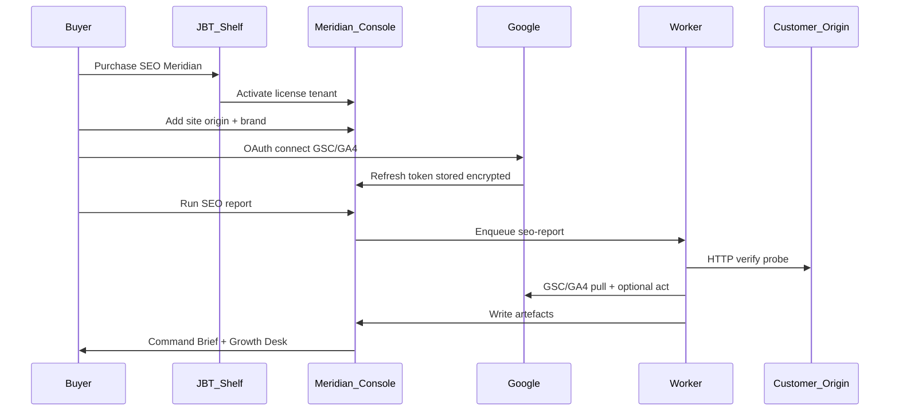

# Meridian SaaS — Master Design (JBT Product)

> **Product URL:** `https://justxsystems.com/jbt/tools/seo-meridian`  
> **Repo:** [`JustXSystems/seo-tool-meridian`](https://github.com/JustXSystems/seo-tool-meridian)  
> **Local checkout:** `../seo-tool-meridian` (sibling of this monorepo)  
> **Zigma:** stays on in-repo control plane; optional dual provision to SaaS  
> **Status:** **P3 complete** — landing + JBT license webhook; next P4 Product Agents

---

## 1. Vision (what you are building)

**Meridian is not “another SEO checklist.”** It is a **purchasable JustX Business Tool (JBT)** that:

1. A customer **buys** inside the JBT shelf on JustX Systems.
2. They **connect an existing website** (WordPress, Shopify, custom, Next, whatever).
3. Meridian runs the **control-plane forever loop** for that origin: verify → signals → Command Brief → Growth Desk → scheduled jobs → alerts.
4. Where Google/Bing allow it, Meridian **acts** (sitemap submit, URL inspect, indexing queue).
5. Where the customer’s CMS allows it, optional **Product Agents** apply safe on-site fixes (meta, sitemap hints, schema patches) — never spam, never thin doorway pages.

**Zigma Technologies** remains the reference customer and keeps today’s architecture (product plane in Next, Meridian CLI + Actions). Zigma can **also** appear as a site inside the SaaS desk so JustX ops has one corporate console later.

```
┌──────────────────────────────────────────────────────────────────────────┐
│  justxsystems.com                                                        │
│  /jbt                        → Tools marketplace (catalog, purchase)     │
│  /jbt/tools/seo-meridian     → Meridian SaaS console (this product)      │
└──────────────────────────────────────────────────────────────────────────┘
              │ license activate
              ▼
┌──────────────────────────────────────────────────────────────────────────┐
│  Meridian Control Plane (multi-tenant)                                   │
│  Tenants → Sites → Secrets → Jobs → Artefacts → Schedules → Webhooks     │
│  Engine: packages/meridian (extracted)                                   │
└──────────────────────────────────────────────────────────────────────────┘
              │ HTTP probe + Search APIs          │ optional Agent API
              ▼                                   ▼
┌─────────────────────────┐            ┌──────────────────────────────────┐
│ Customer website        │            │ Product Agent (optional)         │
│ (any stack — target)    │            │ WP plugin / Next SDK / webhook   │
│ Googlebot still fetches │            │ Applies meta/schema when allowed │
│ THIS origin             │            └──────────────────────────────────┘
└─────────────────────────┘
```

---

## 2. Non‑negotiable truth (sell honestly)

| Claim | Reality |
| --- | --- |
| “Complete SEO automation” for **any** site | **Control-plane complete** yes (observe + Google/Bing act + briefs). **On-site HTML/CMS mutation** only with an Agent or customer applying desk actions. |
| Copy `/admin` from Zigma onto customer site | **Not required** for SaaS buyers. Their desk is `…/jbt/tools/seo-meridian`. |
| Meridian inside customer’s web root | **Forbidden** (same blast-radius rule as Zigma). SaaS hosts the engine. |
| Auto-index thin city pages / auto-send reviews | **Never** — quality gates stay product policy. |

**Positioning line for JBT:**  
*“Meridian runs your SEO command center — Search Console, Bing, technical verify, Command Brief, and growth actions — without installing an SEO ops stack on your production servers.”*

---

## 3. Deep investigation — architectural options

### 3.1 Where the product lives

| Option | Pros | Cons | Verdict |
| --- | --- | --- | --- |
| **A. Path app** `justxsystems.com/jbt/tools/seo-meridian` | Matches your URL vision; one corporate domain; JBT shelf feels unified | Needs `basePath`; reverse-proxy discipline; cookies/path careful; long SEO jobs must not block JustX marketing PM2 | **Chosen for UX shell** |
| **B. Subdomain** `seo.justxsystems.com` | Cleaner isolation, cookies, scaling workers | Extra DNS/TLS; less “inside JBT” feel | **Use as API/worker origin if needed** (`api.seo…` or internal) |
| **C. Keep inside zigma-technologies monorepo** | Fast for one brand | Contaminates Zigma blast radius; wrong product boundary | **Reject for SaaS** |

**Recommendation:** Console UI at path **A**; heavy job workers on isolated process/queue (same VPS OK initially, separate PM2 app `jbt-meridian-worker`).

### 3.2 Multi-tenancy model

| Option | Pros | Cons | Verdict |
| --- | --- | --- | --- |
| **Shared DB + `tenant_id` row isolation** | Simple Hostinger deploy; enough for JBT v1 | Careful authz on every query | **Chosen for v1** |
| Schema-per-tenant | Strong isolation | Ops hell on one VPS | Later / enterprise |
| One VM per customer | Max isolation | Not a product; agency model | Reject |

### 3.3 Google / Bing identity (critical)

| Option | Pros | Cons | Verdict |
| --- | --- | --- | --- |
| **Per-tenant OAuth** (JustX Meridian Google Cloud app; each buyer connects their Google) | Correct SaaS; tokens encrypted per site; buyer owns data | OAuth consent UX; refresh-token storage; support when expired | **Chosen** |
| Agency: JustX account manages all GSC | Easy for you | Compliance nightmare; doesn’t scale; buyers lose control | Reject as default |
| Buyer pastes API keys only | Simple | GSC needs OAuth; incomplete | Bing/PSI keys OK; GSC still OAuth |

### 3.4 How far “automation” goes on *their* website

| Layer | What | Works without their code? |
| --- | --- | --- |
| **L1 Observatory** | Live verify, crawl sample paths, sitemap health, PSI | **Yes** — HTTP only |
| **L2 Search Act** | GSC sitemap submit, URL inspect, Bing submit | **Yes** — with their OAuth/keys |
| **L3 Desk intelligence** | Command Brief, Growth Desk, radar, digests, webhooks | **Yes** — SaaS artefacts |
| **L4 Product Agent** | Patch titles/meta/schema/canonicals in CMS | **No** — needs plugin/SDK/webhook |
| **L5 Content factory** | Auto-write & publish thin pages | **Policy reject** |

**v1 ships L1–L3 + L2.**  
**v1.5 ships L4 stubs** (WordPress plugin + generic webhook + Next SDK).  
**Never ship L5 doorway automation.**

### 3.5 Job execution

| Option | Pros | Cons | Verdict |
| --- | --- | --- | --- |
| Spawn Meridian CLI in worker with hydrated env | Reuses proven engine | Process management; disk artefacts | **Chosen** |
| Rewrite engine as pure library in Next route handlers | Elegant | Timeouts; mixes web & CPU; hard to debug | Reject for report jobs |
| GitHub Actions per tenant | Familiar from Zigma | Not multi-tenant SaaS; secret sprawl | Reject for product |

### 3.6 Zigma relationship

| Option | Pros | Cons | Verdict |
| --- | --- | --- | --- |
| **Leave Zigma Meridian as-is; add optional SaaS bridge** | Zero risk to Production SEO today | Two desks until you choose | **Chosen** |
| Migrate Zigma reports to SaaS immediately | One desk | Couples Zigma uptime to new product | Too early |
| Delete in-repo Meridian | Clean | Breaks current forever ops | Reject |

---

## 4. Master architecture

### 4.1 Repos & deploy units

```
JustXSystems/seo-tool-meridian          ← NEW product repo
├── apps/console/                       ← Next.js (basePath /jbt/tools/seo-meridian)
├── apps/worker/                        ← job runner (PM2)
├── packages/engine/                    ← copy of packages/meridian (CLI)
├── packages/sdk/                       ← optional customer Product Agent SDK
├── packages/db/                        ← schema + migrations
└── docs/                               ← SETUP, BILLING, SECURITY

JustXSystems/zigma-technologies         ← UNCHANGED control plane default
└── optional: MERIDIAN_SAAS_* bridge    ← dual provision
```

Deploy on JustX Hostinger (or same org VPS):

| PM2 / unit | Role |
| --- | --- |
| `justx` (existing) | Marketing site; reverse-proxy `/jbt/tools/seo-meridian` → console |
| `jbt-meridian-web` | Console Next standalone |
| `jbt-meridian-worker` | Queue consumer; runs `meridian act seo-report` |

### 4.2 Domain model

```
Tenant (purchaser / org)
  ├── License (JBT entitlement, plan, seats, expiresAt)
  ├── Users (email, role: owner|operator|viewer)
  ├── ApiKeys (hashed; for external desk embed)
  └── Sites[]
        ├── profileJson (origin, brand, samplePaths, gsc.siteUrl, …)
        ├── Secrets (encrypted): google refresh, bing, psi, webhook
        ├── Schedule (cron: weekly report, …)
        ├── Jobs[] (status, startedAt, finishedAt, error)
        └── Artefacts[] (command-brief.html, growth-desk.html, …)
```

Encryption: AES-256-GCM with `MERIDIAN_SAAS_MASTER_KEY` (KMS later). Never log secrets.

### 4.3 Buyer journey (the product)



### 4.4 API surface (v1)

| Method | Path | Purpose |
| --- | --- | --- |
| `POST` | `/api/v1/sites` | Register site (origin, brand) |
| `POST` | `/api/v1/sites/:id/oauth/google/start` | Begin OAuth |
| `POST` | `/api/v1/sites/:id/jobs` | `{ type: "seo-report" \| "observe" \| "verify" }` |
| `GET` | `/api/v1/sites/:id/jobs/:jobId` | Job status |
| `GET` | `/api/v1/sites/:id/artefacts/:name` | Brief / growth / json |
| `POST` | `/api/v1/sites/:id/webhooks/test` | Alert channel |

Auth: session cookie for console UI; `Authorization: Bearer jbt_…` for API keys (Zigma bridge, agents).

### 4.5 Console UX (corporate, minimal)

1. **Sites** — list origins, connector traffic lights  
2. **Command** — last Command Brief (iframe/artefact) + Generate report  
3. **Growth** — Growth Desk + human actions checklist  
4. **Connect** — Google OAuth, Bing key, PSI key, webhook  
5. **Schedule** — Sunday report default  
6. **License** — plan status from JBT  

No phase 0–33 archaeology in the buyer UI.

### 4.6 What “complete automation” means in v1 (product contract)

**Automatic forever (no buyer click after setup):**

- Weekly (and on-demand) live verify + Command Brief + Growth Desk  
- Connector health + webhook on verify fail / auth expired  
- Trend vs prior window when GSC connected  

**One-click (buyer):**

- Connect Google  
- Generate report now  
- Submit sitemap / inspect URLs  
- Apply Growth Desk recommendations (copy titles, FAQ — or Agent apply if installed)  

**Never automatic:**

- Fake reviews, paid links, thin city index floods, mass AI doorway pages  

---

## 5. JBT commerce integration

Until a full JBT platform API exists, use a **license bridge**:

1. Purchase on JustX/JBT issues a **license key** (`JBT-MER-…`).  
2. First login to Meridian console → redeem key → creates Tenant + License.  
3. Later: JBT webhook `license.activated` / `license.revoked` hits Meridian admin API.

Plans (suggested):

| Plan | Sites | Cadence | Agents |
| --- | --- | --- | --- |
| Starter | 1 | Weekly report | L1–L3 |
| Growth | 3 | Weekly + midweek verify | + webhook |
| Agency | 15+ | Daily observe | + WP/Next agents |

---

## 6. Zigma dual provision (keep current magic)

Zigma **does not** move off in-repo Meridian yet.

Optional env on Zigma Production (when SaaS is live):

| Variable | Purpose |
| --- | --- |
| `MERIDIAN_MODE` | `local` (default) \| `saas` \| `dual` |
| `MERIDIAN_SAAS_URL` | `https://justxsystems.com/jbt/tools/seo-meridian` |
| `MERIDIAN_SAAS_API_KEY` | Site API key from SaaS |
| `MERIDIAN_SAAS_SITE_ID` | Zigma site id in SaaS |

Behavior:

- `local` — today’s GitHub Actions + desk (unchanged).  
- `dual` — local forever ops **and** Admin link “Open Meridian SaaS desk”.  
- `saas` — Admin Generate report dispatches SaaS job; local CLI optional fallback.

Register Zigma as the first tenant site after SaaS boots (dogfood).

---

## 7. Security & compliance

- Per-tenant encrypted secrets; master key only on worker + web.  
- OAuth tokens never in artefacts HTML.  
- Artefacts `noindex`; console behind auth.  
- Rate-limit jobs per tenant.  
- Audit log: who ran report / who connected Google.  
- Data residency: artefacts under `/var/jbt-meridian/tenants/<id>/…`.  
- Buyer disconnect deletes refresh token.

---

## 8. Implementation phases (after design approval)

| Phase | Deliverable | Outcome |
| --- | --- | --- |
| **P0** | Create `JustXSystems/seo-tool-meridian`; extract engine; README + this design | Repo exists |
| **P1** | Console + DB + tenant/site/license redeem + worker seo-report | Dogfood on one external URL |
| **P2** | Google OAuth per site; Command Brief + Growth Desk UI; schedules; webhooks | Real JBT buyer path |
| **P3** | JBT license webhook; marketing page under `/jbt/tools/seo-meridian` public landing | Sellable |
| **P4** | Product Agents (WP + generic webhook + Next SDK) | On-site apply |
| **P5** | Zigma `MERIDIAN_MODE=dual` bridge in Admin | Corporate single pane later |

**Do not** block Zigma Production deploys on P0–P5.

---

## 9. Risks & mitigations

| Risk | Mitigation |
| --- | --- |
| Overselling “full SEO” without Agents | Honest L1–L3 contract in marketing copy |
| OAuth support burden | Excellent Connect wizard + `auth_required` alerts |
| Long reports starve JustX web | Separate worker PM2; queue |
| Secret leak | Encryption + no secrets in artefacts + audit |
| Engine drift vs Zigma package | Versioned `@justx/meridian-engine`; periodic sync from zigma or make Zigma depend on npm later |
| Path `basePath` bugs | Integration tests for asset/API paths |

---

## 10. Decision record (locked for v1)

1. **New repo** `JustXSystems/seo-tool-meridian` — product, not Zigma submodule.  
2. **Console URL** `https://justxsystems.com/jbt/tools/seo-meridian` with Next `basePath`.  
3. **Multi-tenant shared DB** + encrypted per-site secrets.  
4. **Per-tenant Google OAuth** (JustX Cloud OAuth app).  
5. **Worker + queue** runs Meridian engine; web never hosts long CLI.  
6. **v1 automation = L1–L3 + Search Act**; Agents later.  
7. **Zigma stays local Meridian**; optional dual bridge only.  
8. **Quality gates** (no thin auto-index, no auto review email) remain law.

---

## 11. Success metrics

- Time from purchase → first Command Brief **&lt; 30 minutes** (with Google connect).  
- Weekly job success rate **≥ 95%** (auth failures counted separately).  
- Zigma Production deploy unaffected (zero coupling).  
- Buyer NPS: “I open one desk, not six Google tabs.”

---

*This document is the product constitution for Meridian as a JBT SaaS tool. Implementation starts at Phase P0 when you say proceed.*
